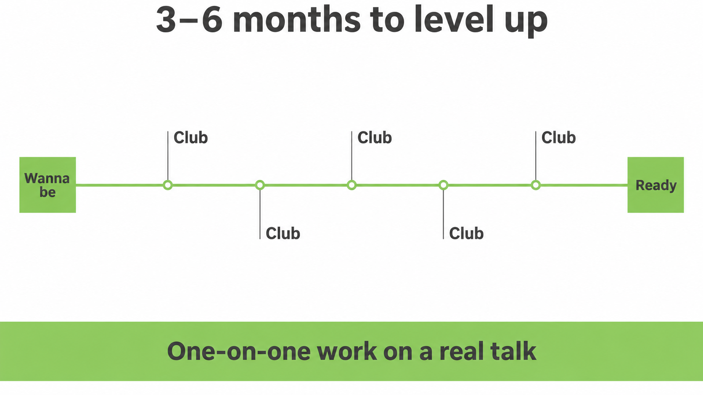
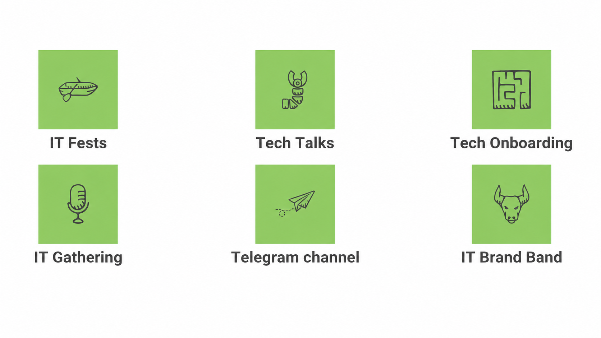

# “What if our speakers get poached?!” Why and how to train engineers to speak in public

**Jane Goleva (@cheaffa)**  
Originally published on 24 November 2020 in the Lamoda Tech corporate blog on Habr.

[Read the original Russian article](https://habr.com/ru/companies/lamoda/articles/528888/)

*Complete English translation of my original Russian article. The text reflects the programme and my perspective as of November 2020. English-localised adaptations of the original illustrations are embedded in their original positions.*

---

Hi! I'm Jane Goleva, and I've been working in developer relations at Lamoda for four years. Our process for preparing speakers is now well established and runs smoothly, but that wasn't always the case. When I first started, my suggestion that people give talks met with resistance from both developers and team leads.

If you're interested in the practical benefits that employee conference talks bring to a company — or if you'd already like to build a culture of public speaking but have no plans to hire a DevRel specialist — I think our experience will be useful to you.

## Why companies need public speaking

Four years ago, Lamoda already had a large IT department. A broad technology stack, established processes, interesting problems for developers at every level, from juniors to seniors. The only trouble was that nobody outside the company knew about it.

The candidates we were interested in were reluctant to agree to interviews, despite the attractive terms in our job postings. And those who did come were genuinely surprised: “Wow, I thought you just sold clothes!”

People simply had nowhere to learn how things worked inside the company. There were no articles, no talks. In effect, we had no tech brand.

To start developing one, we needed more than the management's approval. We were missing the foundation: brand ambassadors. Technical specialists who both could and wanted to speak on behalf of the company. And not just talk about their own projects, but also keep up with the most interesting things their colleagues were working on.

By then, the company had accumulated plenty of great case studies. But our engineers didn't know how to write articles or give talks and, most importantly, didn't understand why they should.

So my first task was to explain all this to the team leads. Here were my main arguments.

### 1. A well-known company hires more efficiently

Market awareness expands our candidate funnel. That means more motivated candidates come to our interviews. They already know that Lamoda is a substantial e-commerce business with 300 engineers, seven departments, automated logistics, and so on. Candidates are already interested in working with us. If they're not, they're unlikely to agree to an interview in the first place.

### 2. Our employees want to be proud of what they do

When you go to a major conference and hear talks not only from people at other companies but also from your own colleagues — or, better still, tell an interested audience about an interesting problem you and your team solved — you start to feel proud of your work. Recognition is an important part of an engineer's motivation. It's a natural need for any employee, and an employer should give people the opportunity to meet that need.

## But what if they do get poached?!

So we got into content marketing: we decided to talk and write publicly about our expertise. I know how to prepare people for public speaking, so that's where we started. At the time, however, most managers were afraid that competitors would poach our speakers after conferences. For ten years, I'd heard the same question: “What if we train them and they leave?” “Fine, but what if we don't train them and they stay?” was my reply.

On average, people in the IT industry change jobs roughly every year and a half to two years. That's normal.

Generally speaking, the process looks something like this:

1. For the first six months, a new hire settles in and gets to grips with the processes, the product and what we're doing as a whole.
2. For another six months, they do something cool and interesting that they could talk about at a conference if they wanted to.
3. The company then has just six months to a year to prepare them, send them to give a talk and, together with them, meet the new people they'll bring in.

A good talk lives on and attracts candidates for several years. First, people hear it at a technical conference. Then the organisers upload it to YouTube and publish a transcript on Habr, reaching even more developers. A good talk will benefit the company even if the speaker resigns immediately afterwards.

## Why should I talk about this? Everyone knows it already!

I'd managed to convince the team leads, but the engineers themselves weren't exactly keen on speaking in public. To begin with, I tried to explain what they personally stood to gain from giving talks regularly. (Grigory Petrov has a great talk on this subject, [An Engineer's Personal Brand](https://youtu.be/tKIjo_RIZTs).) Once they could picture the possibilities, a few people got excited about giving a talk. But another problem arose: we had no clear idea what we could talk about at conferences.

I often heard doubts like these: “Why give a talk at all when you can always go to the documentation or Habr and read everything there?”

With each prospective speaker, I'd discuss the topic and what made it distinctive. My reasoning usually went something like this: a technical conference isn't a dissertation defence, or an occasion for you to teach people how to live. No, a conference is an opportunity to share your experience. Yes, it won't cover everything, because every company has its own unique zoo of technologies. Other companies have different systems, environments and ways of implementing things. We'll share our own experience, and we'll do it well.

After all, we're prepared to share the details without sugar-coating anything: the mistakes, the discoveries and the results. And that's what makes any talk valuable.

I talk to every potential speaker, but I try not to push too hard. If someone categorically rejects a topic, I'm inclined to trust them. They're the expert in their field; they know better.

## I can't speak in public at all. It's just not my thing!

Many engineers find it difficult to take the plunge. They're often afraid of speaking and don't know how to do it. Meanwhile, I dreamed of seeing my colleagues give talks at one of the biggest conferences, HighLoad, in 2016. So I secured the support of our CTO and suggested to team leads across the organisation that we start by giving talks internally, to learn how to do it well.

That's how our Friday event, IT Fest, was born. A representative of each team would talk about what they were working on, which technologies they used, how they organised their processes, and so on.

To launch the first season of these events, I brought all the speakers together for three training sessions and taught them public speaking. They enjoyed it so much that they suggested making the meetings a regular thing. Together, we came up with Speakers Club. It gave us a safe space to practise public speaking regularly.

We agreed from the outset that the club had specific goals: we needed a safe space where novice speakers could learn public speaking and receive high-quality feedback. You can read more about how Lamoda Speakers Club worked in [this Habr article](https://habr.com/ru/companies/lamoda/articles/463099/) and watch the talk on [YouTube](https://youtu.be/Eqtzj2JIJQw).

## Getting it right the first time

As we gained momentum, we had more and more talks. I couldn't keep up with preparing everyone. I'd have had to clone myself, but nobody had invented that technology yet :( The developers I'd taught to give feedback became my co-trainers. Now we prepare other speakers together.

At this pace, we reached October, when there was still time to submit at least meetup sessions to HighLoad. By then, we had people for whom giving talks had become second nature. We submitted our talks and put forward five meetup sessions for the conference programme. We did pretty well.

After looking around and listening to other talks, my engineers said, “Well, we can do that too!” Success. Off we go!

In addition to our talks at HighLoad++, we had our own booth. It was important to me that my colleagues talk to developers from other companies at the conference. That way, they could get a better sense of what interested an external audience, what people knew about us and, for example, what they thought about a particular technology.

Over the two days, my speakers had a chance to talk to the audience both at the meetups and at the booth. Those conversations helped them identify topics for new talks. They also lost their fear of the unknown. The format made more sense to them now. The audience turned out to be friendly, curious people who were enjoyable to talk to. Having a booth helped enormously with developing our speakers. Since then, Lamoda has delivered 20–30 conference talks every year.

## The challenges of developing speakers: level up

### 1. I'm toxic, he's toxic

As soon as people learned to give decent talks, new difficulties arose. The slightly more experienced speakers began criticising other speakers harshly.

> Unfortunately, in Russian culture generally, and in engineering culture in particular, people tend to criticise every little thing and overlook genuinely significant achievements. This behaviour devalues both other people's experience and our own. You have to keep working on the culture of communication and interaction; otherwise, people fall back into criticism out of habit.

First of all, criticism gets in the way of the critic themselves. Before becoming an experienced speaker, every beginner would sing me their imposter syndrome aria. They'd tell me they couldn't speak, couldn't string two words together and were terrible in front of an audience. I'd reassure them that one of the aims of Speakers Club was to make speaking safe. By ridiculing other speakers, a person destroys that atmosphere of safety. After all, every newcomer will be afraid that the next sarcastic joke will be at their expense.

To prevent people from making fun of talks, I introduced a rule: in every round of feedback, I asked people to identify at least three things the speaker had done well. It helped a great deal.

### 2. We need new blood

Six months after Speakers Club started, the original group began to drift away. Some had a new project, a new position or a family. To attract new people, we organised a New Year Speakers’ Club Party. All our students gave talks as if it were a graduation ceremony and showed off what they'd achieved. We advertised the event with posters and a mailing, inviting anyone who was interested. And they came, and even brought their friends :) At the next Speakers Club meeting, we had newcomers from our New Year party.

We quickly realised that it takes about three to six months to develop a beginner. It's important that they have a real talk by the end of that time, something they can give at least at our internal IT Fest meetup. Otherwise, they lose motivation and leave.

### 3. Talks aren't real work!

“Leave us alone, Jane. We're doing real work here. We're coding. What talks are you on about?” was something I often heard from the engineers. To put an end to that, I reached an agreement with the CTO and department heads that preparing talks would officially count as working time. We created a separate Jira project where people could log that time. Talk preparation officially became working time, accounted for in the sprint.

After six months to a year, managers noticed a practical result of the talks: people who had seen them started turning up for interviews. After that, we agreed that speaking at conferences would also be recognised as a work achievement in performance reviews.

The speakers also realised that giving talks was interesting. They'd spent a great deal of time working away at their projects, and preparing a talk gave them an opportunity to stop and take a good look at what they'd achieved. It turned out they had something to be proud of, and that had a positive effect on their motivation.

## A culture of public speaking

It was very important to me that a culture of public speaking took root in the company. I wanted it to become a familiar, even ordinary, thing for many of our engineers.

- It's rather strange to talk about your company at conferences when you don't really know what's going on inside it. IT Fest was the first step towards sharing information between teams. People started talking about what they did. Their colleagues realised that they were surrounded by great professionals working on interesting projects.
- Then people realised that they could talk not only about projects but also about technologies, tools they'd tried and processes they'd introduced. Nowadays, some of those Tech Talks happen without me even knowing about them. Anyone can schedule a meeting, invite their own team and neighbouring teams, and share something that might be useful to others.

- Lamoda has a corporate onboarding programme. On top of that, we created a technical onboarding programme to introduce new hires to our technologies and departments (E-commerce, Business Process Automation, D&A and Infrastructure). Thanks to this, Speakers Club members can talk not only about their own team's achievements but also about what's happening across the company.
- Tech Gathering: every three months, department heads bring all the tech teams together to tell them what we've done well over that period, what our plans are and what our key projects are. It gives managers a reason to speak in public, learn how to do it and, along the way, understand how difficult it is.
- We also have a shared Telegram channel where I talk about our employees' talks and the ratings they received, their Habr articles, the latest podcasts, and so on. People who don't want to give talks themselves at least read about them and understand that this work matters and is valued.

> At one Tech Gathering, without much faith that anything would come of it, I mentioned that it was time for us to start writing articles for Habr. To my surprise, as soon as the meeting ended, people started sending me private messages with their suggestions. Talking to people works.

Besides that, we have a separate Tech Brand Band chat for our brand ambassadors, where we regularly discuss all sorts of things, from an article for the website to the design of a company T-shirt. I think any brand should grow from the inside out. If we think our idea is cool ourselves, it'll attract like-minded people and filter out those who aren't a good fit.

## Why do people stay?

Let's go back to the test question we started with: “What if we send our specialists to give talks and they get poached there?”

Firstly, a good talk keeps attracting new employees for several years, so ultimately, giving talks is always beneficial to the company.

Secondly, I'm actually less worried about an engineer who regularly speaks on behalf of Lamoda at conferences. In fact, I believe they're less likely to leave, because their decision to work with us becomes a more conscious one.

When I was trying to articulate what was good about our company with one brand ambassador, I asked him, “Listen, why do you stay here?” If someone can't find an answer to that question, there's a good chance they'll leave. Well, my engineers have been answering that question for themselves all these years. If someone has an answer for themselves, there's no need to worry after that.

We have stories of employees who were offered a new position or a higher salary after a talk. Some turned the offers down; some accepted. Yes, people do sometimes leave, and that's normal.

Sometimes people come back to us, and more than once :) And then I ask them why they came back. The answer helps us better understand what makes us unique and why people enjoy working with us.

If someone can explain why they like working at the company (and genuinely do), their talks will attract new people, and they'll stay with us for a long time.

---

[Original article in Russian](https://habr.com/ru/companies/lamoda/articles/528888/)

*Illustration note: the five images are English-localised adaptations of the original illustrations. The Russian originals are available in the Habr article linked above.*
